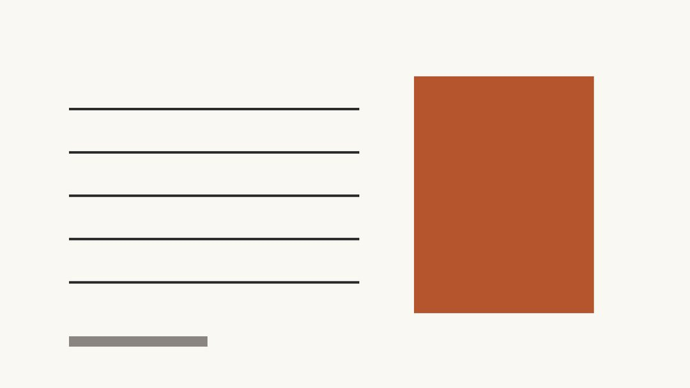

:::lead
我把同一篇稿子用三种参数排了三遍，发给同事盲选。他们选中的那版，只改了行高、字距和段距。
:::

## 一、先看一组对照

多数人调排版，第一步是换模板、换颜色、换字体。这三件事对「看起来干净」的贡献，其实排不进前三。

真正决定观感的是三个数字：**行高**、**字距**、**段距**。它们决定了文字块是「挤成一团」还是「呼吸得开」。

## 二、三个参数的具体值

==行高 1.8、字距 0.5px、段距 1em==，这三个值在手机上几乎不会出错。

- 行高低于 1.6，两行会黏在一起；高于 2.0，读者会找不到下一行。
- 字距主要解决中英混排的「结块」问题，0.5px 足够，1px 就显得松。
- 段距用 1em（16px）而不是空行，空行在微信里会被合并。

:::card 为什么是 1.8
16px 字号 × 1.8 = 28.8px 行高。这个值刚好让汉字上下的留白接近半个字高，是中文屏幕阅读最舒服的区间。
:::

## 三、容易忽略的两件事

:::notice
不要在段落里手动加空格来「撑开」文字。微信会吃掉首尾空格，中英之间也会错位，统一用 letter-spacing。
:::

第二件事是**段长**。手机屏一行大约 17–19 个汉字，一段超过 4 行就会劝退。把长段拆成 3 行一段，阅读完成率会明显上升。

> 排版不是让页面变好看，是让读者少做一次判断。

## 四、今天就改这三个值

打开你上一篇推文，只改行高、字距、段距，再发一次预览。差别会比换十套模板更明显。

:::end
如果这篇有用，转给那个总在改稿的人。下周三聊「封面为什么总被裁」。
:::
